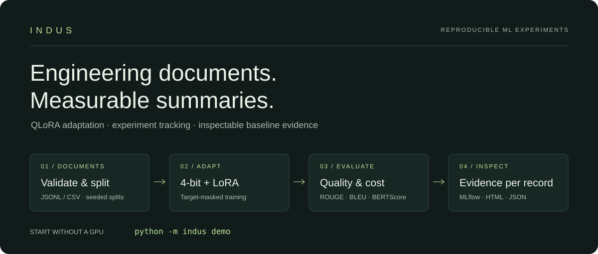
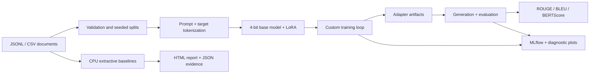
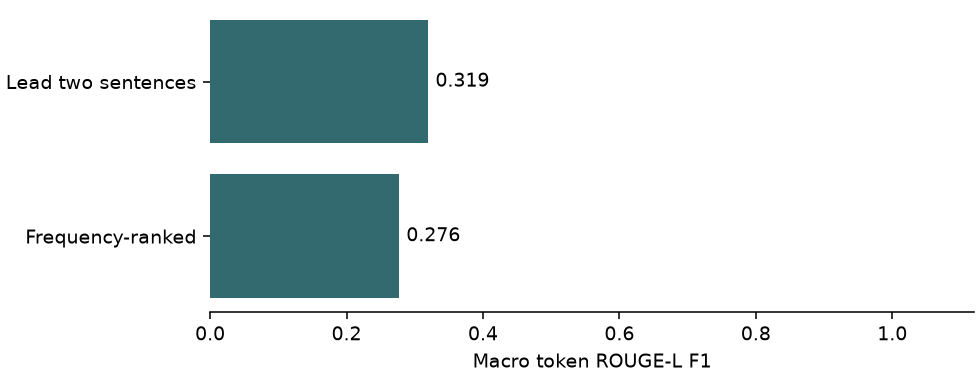

# Indus

**Reproducible fine-tuning for engineering document summarization.**

A QLoRA experimentation pipeline with target-only training, MLflow tracking,
quality evaluation, and inspectable CPU baselines.



Engineering reports contain dense measurements, findings, and recommendations. Indus
provides a small, inspectable framework for adapting causal language models to summarize
these documents, comparing outputs with references, and recording the cost of inference.

## Quick start

Python 3.11 or 3.12 is recommended. The CPU demo has **no third-party runtime dependencies**,
requires no credentials, and downloads no models.

```bash
python3 -m venv .venv
source .venv/bin/activate
python -m pip install -e .

indus validate data/sample/eng_summarization_sample.jsonl
indus demo
```

Open `outputs/demo/report.html` in your browser. It includes both baseline scores and
expandable records showing the source, reference, and generated summaries. The same run
writes `metrics.json` and `predictions.jsonl` for further analysis.

```bash
# Use your own JSONL or CSV and change the extraction budget.
indus demo --data path/to/documents.jsonl --sentences 3 --output outputs/custom
# Equivalent module invocation:
python -m indus demo
```

The package is not published to PyPI; install it from this repository. Training scripts
run from the repository root, while the installed `indus` CLI works from any directory
when you supply an absolute `--data` path.

## Verification

```bash
python -m pip install -e '.[dev]' torch 'transformers>=4.40,<5' 'peft>=0.10,<1'
ruff check src tests scripts
black --check src tests scripts
pytest
python -m build
```

The lightweight developer extra covers data, metrics, plots and tracking. Torch,
Transformers and PEFT enable the training-loop regression test; it is skipped when these
are unavailable. CI installs them and runs the complete CPU suite, generates the demo,
and verifies that a built wheel runs in an isolated environment outside the checkout.

See [CONTRIBUTING.md](CONTRIBUTING.md) for contribution guidance and
[engineering notes](docs/engineering.md) for implementation details and evaluation limits.

## What you can inspect

- **QLoRA pipeline:** 4-bit NF4 loading, configurable LoRA adapters, target-only loss,
  linear warmup and cosine scheduling, gradient clipping, and accumulation including partial windows.
- **Experiment tracking:** Hydra configurations, MLflow parameters and artifacts,
  validation losses, gradient norms, and memory snapshots.
- **Evaluation:** ROUGE-L, sacreBLEU, BERTScore, per-document predictions,
  numeric-fact consistency checks, and inference latency/throughput reports.
- **CPU experiment:** deterministic lead-sentence and frequency-ranked baselines,
  a standalone HTML document explorer, input checksums, and machine-readable results.
- **Verification:** regression tests, wheel installation checks, and GitHub Actions on Python 3.11/3.12.
- **Training artifacts:** best-validation adapter, optimizer/scheduler state, and split manifest.

## Architecture



| Area | Implementation |
|---|---|
| Data integrity | Every record validated; JSON line errors; non-empty deterministic splits |
| Training objective | Prompt and padding masked with `-100`; target EOS preserved |
| Optimization | AdamW, warmup/cosine schedule, configurable accumulation and clipping |
| Generation | Greedy or sampled decoding; left padding for batched causal generation |
| Profiling | CUDA peak allocation and synchronized generation timing; system RAM snapshots |
| Reproducibility | Seeded splitting, resolved configs in MLflow; CPU report input SHA-256 |

## Training

QLoRA requires a supported **NVIDIA CUDA GPU on Linux** with bitsandbytes. Mac/CPU users
can run the demo and tests; the default 7B QLoRA setup is not a CPU training recipe.
VRAM requirements depend on sequence lengths, batch size, model and software versions.
Model access and license terms must be satisfied separately.

```bash
python -m pip install -e '.[train]'
python scripts/train.py

# Compare adapter ranks with isolated output directories.
python scripts/train.py training=qlora_r8 output_dir=outputs/r8
python scripts/train.py training=qlora_r32 output_dir=outputs/r32

# Evaluate the adapter saved in the selected output directory.
python scripts/evaluate.py output_dir=outputs/r8 training=qlora_r8
python scripts/infer.py output_dir=outputs/r8

# Untuned baseline and configurable experiment matrix.
python scripts/run_baseline.py
python scripts/run_sweep.py

# Inspect local experiment tracking.
mlflow ui --backend-store-uri ./mlruns --port 5000
```

The workflow validates once per epoch and saves the best-validation adapter under
`outputs/checkpoints/best_adapter`, along with optimizer/scheduler state and
`best_metrics.json`; that adapter is copied to `outputs/adapter` for evaluation.
It also writes `outputs/split_manifest.json` with seed, source filenames, and document IDs.
Some original configuration fields (`eval_steps`, `save_steps`, `save_total_limit`,
`fp16`, `bf16`, `lr_scheduler_type`) are reserved and do not alter this custom loop;
quantization compute dtype and model dtype are configured separately. The sweep script
orchestrates training; run evaluation for each output directory to compare model quality.

For containers, `docker compose run --rm training` uses the CUDA-enabled PyTorch base
image and mounts local data and outputs. Docker and an NVIDIA container runtime are
required. Container builds and GPU training are not exercised by the CPU CI job.

## Data format

```json
{"document_id":"DOC-001","source_text":"Inspection found corrosion at Pier 3. Repair is recommended.","target_summary":"Pier 3 corrosion requires repair."}
```

JSONL contains one object per line; CSV uses the same column names. Training can override
column names and the prompt template through `configs/data/eng_summarization.yaml`.
The CPU CLI uses the default column names. The optional `split` field in the sample data
is descriptive; training creates its own seeded splits unless separate files are supplied.

**Avoid leakage:** use project/topic-disjoint train, validation and test files for a real
experiment. A random split of this template-based sample is useful only for a pipeline
smoke test. `indus validate` reports exact source and reference cardinality; it does not
prove that near-duplicate templates are absent.
The split loader rejects a document ID or exact source text appearing in more
than one split, including when you provide separate files. You must still
inspect near duplicates and related projects yourself; exact matching cannot
establish a topic-disjoint evaluation.

## CPU baseline results on the bundled dataset

[Checked-in CPU run](reports/cpu-baseline/metrics.json) ·
[Prediction records](reports/cpu-baseline/predictions.jsonl) ·
[Experiment protocol](reports/experiment_protocol.md)



The bundled CPU run scored 0.318917 macro token ROUGE-L F1 for the lead-sentence baseline and 0.276204 for frequency ranking. These results use 100 synthetic records and are a pipeline check, not evidence of general summarization quality.

## Evaluation protocol and limitations

| CPU method | Macro token ROUGE-L F1 |
|---|---:|
| Lead two sentences | 0.318917 |
| Frequency-ranked two sentences | 0.276204 |

Frequency ranking does not outperform the lead baseline on this corpus. There are 100
records but only five unique reference summaries, which limits the value of aggregate scores.

The checked-in results are actual executions of the CPU extractive baselines on the
bundled synthetic corpus. The demo measures macro token ROUGE-L F1 with lowercase word
tokens and **no stemming**. This differs from the stemmed `rouge-score` metric used by
the LLM evaluator. Both use a 0–1 scale; the BLEU wrapper also normalizes sacreBLEU to 0–1.
Do not compare their numbers as if tokenization and evaluation protocols were identical.

No measured QLoRA quality improvement, GPU memory reduction, or LLM throughput claim is
made. The sample data has repeated templates and references, and is not a real-world
benchmark. CPU timings measure one summarization pass per document, excluding data loading
and scoring; they vary by machine. Engineering summaries require human review before use.

## License

[MIT License](LICENSE) for the project code. Base models and external datasets retain their own licenses.
